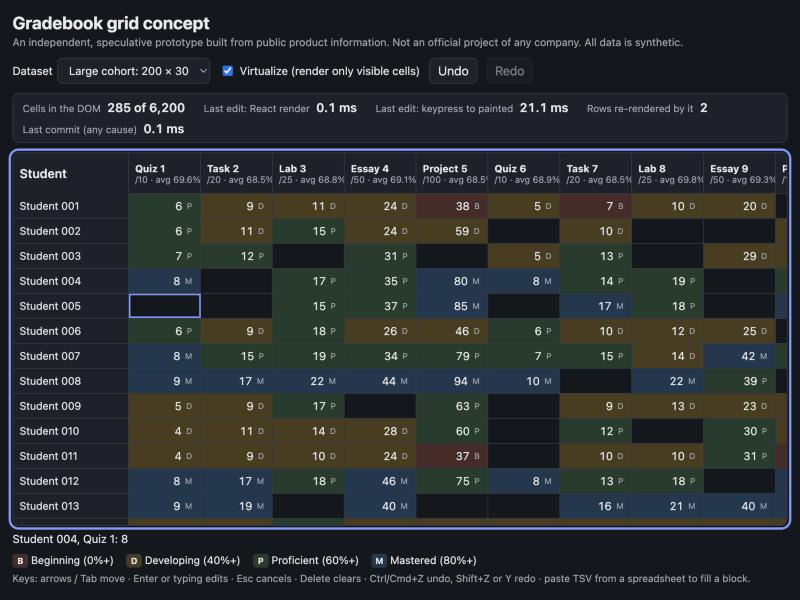

# Gradebook Grid Concept

[](https://github.com/chinthanshetty07/gradebook-grid-concept/actions/workflows/ci.yml)

A keyboard-first, virtualized gradebook built with React and Redux Toolkit. It is a small, working answer to one
question: **how do you keep a spreadsheet-sized gradebook instant to edit?**

> **Independent concept.** I built this on my own from public product information about
> [Toddle](https://www.toddleapp.com/) after reading their frontend engineer posting. It is not an official Toddle
> project, uses no Toddle code or data, and every student name and score is synthetic.



## Why this prototype

What I could verify from public pages:

- Toddle's [assessments and gradebook page](https://www.toddleapp.com/product/assessments-gradebook/) leads with
  "grade them 80% faster", and its other pages describe large cohorts of schools and educators.
- Their Associate Software Engineer, Frontend posting asks for React and Redux, and describes growing into
  "performance and frontend infra projects" with React Profiler and memory profiling.

What I am **not** claiming: that Toddle's gradebook is slow or has any problem. I have never used it. This is a
hypothesis-driven exercise: *if a teacher pastes a column of marks from a spreadsheet into a 1,000 x 60 grid, can the
UI stay responsive?* I wanted to find out where the cost actually lives, and measure it.

## What it does

- **Windowed rendering.** Only the visible rows and columns are in the DOM (285 cells of 6,200 on a 200 x 30 class).
- **Keyboard-first editing.** Arrows, Tab, Home/End, PageUp/PageDown to move; Enter, F2 or just typing to edit;
  Esc cancels; Delete clears. Typing validates against each assessment's maximum and explains rejections.
- **Spreadsheet paste.** Paste tab-separated text and it fills a block from the active cell. Invalid values and
  cells outside the grid are skipped and reported. A paste undoes as one step.
- **Undo and redo** (Ctrl/Cmd+Z, Ctrl/Cmd+Y or Shift+Z), history capped at 200 steps.
- **Incremental statistics.** Column averages are running totals updated in O(1) per edit. Row averages are cached
  per row array, so one edit invalidates one row.
- **Measured, not guessed.** A panel shows React Profiler render time, rows re-rendered, and keypress-to-painted time.
- **Accessible grid.** ARIA `grid` roles with `aria-activedescendant`, row/column counts and indexes, a polite live
  region for results and errors, and a mastery letter in each cell so meaning is not carried by colour alone.

## What I measured

One run on a 61,000-cell dataset (1,000 students x 60 assessments), production build, in an embedded browser pane.
These are single observations, not a benchmark, so treat the order of magnitude as the finding.

| Mode | Cells in DOM | React render for one edit | Keypress to painted |
| --- | --- | --- | --- |
| Virtualized | 285 | 0.2 ms | **17.9 ms** (about one frame) |
| Not virtualized | 61,000 | 0.4 ms | **1,930 ms** |

The surprising part: React's own work is cheap in **both** modes. Row-level `memo` plus Redux Toolkit's structural
sharing means an edit re-renders 2 rows however big the grid is. The 1.9 seconds is the browser laying out and
painting 61,000 nodes. Memoization alone does not fix that; shrinking the DOM does. Switching virtualization off also
took about 2.2 s just to mount.

## Architecture

```
keydown / paste ──> Grid (viewport) ──dispatch──> gradebookSlice (Redux Toolkit + Immer)
                       │                              │ scores[row][col]   one array per student
                       │ getRange()                   │ colSum / colCount  incremental aggregates
                       ▼                              │ past / future      patch groups for undo/redo
              visible rows x columns                  ▼
              <Row> (memo) ──reads──> getRowSummary (WeakMap cache keyed by row array)
```

- `src/store/gradebookSlice.js`: state, reducers, summaries. All the logic that matters is here and unit tested.
- `src/components/Grid.jsx`: windowing, roving active cell, editing, paste, scrolling, ARIA.
- `src/lib/windowing.js`, `score.js`, `tsv.js`, `data.js`: small pure modules.
- `src/store/perfStore.js`: external store that feeds the performance panel without being part of what it measures.
- Redux Toolkit's dev-only immutability and serializability checks are turned off, because they walk the whole state
  on every action and would dominate the numbers. Immer already guarantees immutability.
- Production builds alias `react-dom/client` to `react-dom/profiling`, because React removes `<Profiler>` from normal
  production builds and the panel would otherwise read nothing.

## Run it

```bash
npm install
npm run dev        # development
npm test           # 35 tests
npm run build && npm run preview   # production build with the profiler enabled (use this for measuring)
```

Open the app, pick **Stress test: 1,000 x 60**, click a cell, type a score and press Enter. Untick **Virtualize** to
see the difference (it will be slow on purpose).

## Tests

35 tests (Vitest, Testing Library, jsdom): score parsing and bounds; mastery band boundaries; TSV parsing; windowing
math; deterministic data; every reducer including undo/redo, paste (invalid and clipped cells) and structural sharing;
aggregates matching a full recomputation after any mix of edits, pastes, undos and redos; and the grid component
(ARIA semantics, windowing, arrow navigation, typing and committing, Escape, the read-only column, undo/redo keys,
paste, accessible labels, and live-region announcements). CI runs the tests and the build on every push.

## Limitations and next steps

- Synthetic data and local state only. No server, no real standards or grading scales; the four mastery bands are
  illustrative.
- jsdom tests cannot prove layout or paint behaviour, so the paint numbers above come from manual runs in a real
  browser. A Playwright test that asserts a paint budget would be the next step.
- Virtualization is hand-rolled for clarity. A production grid would likely use a proven library and add row pinning,
  column resizing and frozen columns.
- Not done: copy out of the grid, multi-cell selection, standards-based (non-numeric) grading, and screen-reader
  testing with real assistive technology.
- Single-run measurements in one browser; I have not profiled memory.

Built by [Chinthan Shetty](https://chinthanshetty.in).
